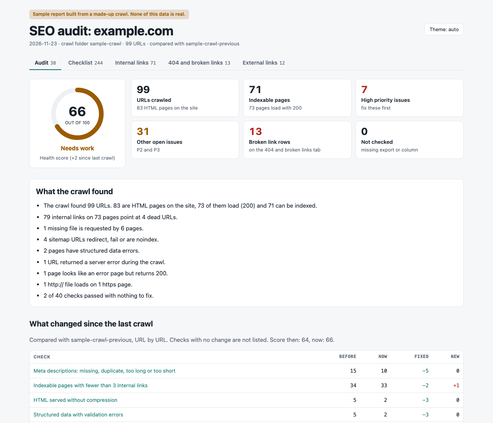
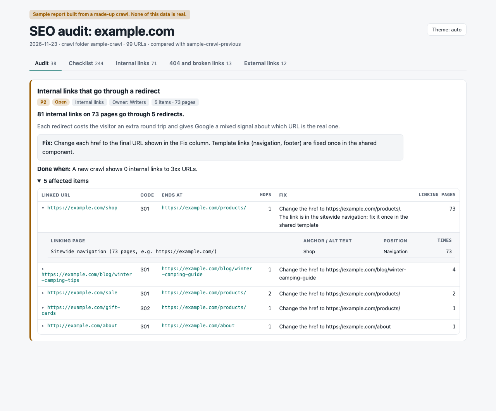

# SEO Audit Dashboard: turn a Screaming Frog crawl into a technical SEO audit developers can fix

A free, open-source Python tool that turns a Screaming Frog crawl export into a technical SEO audit report: one HTML dashboard that works offline, plus an Excel workbook with the same data. Every issue lists the affected URL, every page that links to it (with the anchor text and where on the page the link sits), the exact fix and a "done when" line. Hand it to developers and writers as it is.

Use it as a Screaming Frog report template, an SEO audit for developers, or a repeatable monthly site audit that shows what changed since the last crawl.



> The screenshots and the files in `examples/` come from a **made-up crawl** of `example.com`. None of it is real data.

## What you get

- **A health score out of 100**, a verdict, and a score for each area (crawling, links, sitemap, titles, content, performance, security, structured data).
- **"What the crawl found"** in plain sentences, ranked by impact.
- **40 issue checks** grouped by category, with an owner filter (Developers / Writers / SEO) and a "fix in this order" list.
- **For every issue:** affected URL → each linking page + anchor + position → the fix → "done when". Developer fixes come with copy-ready code (nginx, Apache, JSON-LD, HTML).
- **Navigation and footer links folded into one line**, so a broken footer link shows as "Sitewide footer (73 pages)" with "fix it once in the shared template", not 73 rows.
- **A 244-check SEO audit checklist** in 16 sections. The crawl answers what it can. Checks that need Search Console, analytics, logs or backlink data say "Not checked here" and name the tool you need. Nothing is guessed.
- **Internal links tab:** every indexable page with every page that links to it.
- **404 and broken links tab:** one row per broken link or missing file, with the linking page, anchor and fix.
- **External links tab:** every outgoing link with its status code, and crawler-blocked sites (401, 403, 429, 999) kept apart from dead ones.
- **What changed:** pass `--previous` with an older crawl and every check is compared URL by URL (fixed, new, score before and after).
- **An .xlsx workbook** with Summary, Fix list, Issue details, Developer fixes, Writer and SEO fixes, Checklist, Internal links, Broken links, External links and What changed sheets.

One HTML file, no CDN, no fonts to download, light and dark mode, works on a phone. Email it, attach it to a ticket, or open it from a shared drive.



## Quick start

You need Python 3.9+ and the crawl export folder. Download this repo (Code > Download ZIP, or `git clone`), open a terminal in the folder and install the one dependency (openpyxl, for the workbook):

```bash
pip install -r requirements.txt
```

```bash
python audit.py --crawl path/to/crawl-export --site https://example.com --out report/
```

Open `report/seo-audit.html` in a browser. The workbook is `report/seo-audit.xlsx`.

Compare with an older crawl of the same site:

```bash
python audit.py --crawl crawl-2026-11 --previous crawl-2026-10 --site https://example.com --out report/
```

Try it on the sample data first:

```bash
python examples/make_sample_crawl.py
```

```bash
python audit.py --crawl examples/sample-crawl --previous examples/sample-crawl-previous --site https://example.com --out examples/sample-report
```

### Options

| Flag | What it does |
|---|---|
| `--crawl` | Folder with the Screaming Frog CSV exports. Required. |
| `--site` | The site you crawled. Subdomains count as the same site. Required. |
| `--out` | Output folder. Default `report`. |
| `--previous` | An older crawl folder of the same site, for "what changed". |
| `--sitemap` | Sitemap URL or local XML file. Default: `sitemap/*.xml` or `sitemap_urls.txt` inside the crawl folder. |
| `--name` | Base name of the output files. Default `seo-audit`. |
| `--no-xlsx` | Skip the workbook (openpyxl is then not needed). |

## Export the crawl from Screaming Frog

### From the command line

The exact tab names below are the ones Screaming Frog SEO Spider 24 uses.

```bash
ScreamingFrogSEOSpiderLauncher --headless --crawl https://example.com --save-crawl --output-folder ./crawl --overwrite --export-tabs "Internal:All,Response Codes:All,Page Titles:All,Meta Description:All,H1:All,H2:All,Canonicals:All,Directives:All,Hreflang:All,Images:All,Images:Missing Alt Text,Sitemaps:All,Content:All,Structured Data:All,Security:All,Links:All" --bulk-export "Response Codes:Internal & External:All Error (4xx 5xx & No Response) Inlinks,Response Codes:Internal & External:Redirection (3xx) Inlinks,Links:All Inlinks"
```

Where the launcher lives:

- macOS: `/Applications/Screaming Frog SEO Spider.app/Contents/MacOS/ScreamingFrogSEOSpiderLauncher`
- Windows: `"C:\Program Files (x86)\Screaming Frog SEO Spider\ScreamingFrogSEOSpiderCli.exe"`
- Linux: `screamingfrogseospider`

Add `--config your.seospiderconfig` to use saved settings (crawl speed, subdomains, JavaScript rendering).

### From the app

Crawl the site, then:

1. **Export** the Internal tab (filter: All) as `internal_all.csv`.
2. **Bulk Export > Links > All Inlinks** as `all_inlinks.csv`. This one file gives every linking page, anchor and link position.
3. Optional: Response Codes, Structured Data, Images, Hreflang and Content tabs (filter: All).

Put the CSVs in one folder. Keep Screaming Frog's file names.

### Settings that turn on more checks

| Setting | Turns on |
|---|---|
| Store HTTP response headers | Compression, browser cache, security headers |
| JSON-LD extraction with validation | Structured data errors, missing schema by folder |
| Near-duplicate detection | Near-duplicate pages |
| Readability scores | The readability checklist item |

All four are in Screaming Frog's crawl configuration. Menu names move between versions, so search the configuration for the setting name if you do not see it.

### Which file feeds which check

| File | Needed for |
|---|---|
| `internal_all.csv` | **Required.** Status codes, titles, meta, headings, canonicals, word count, depth, redirects, speed, headers |
| `all_inlinks.csv` | Broken links, redirecting links, anchors, nofollow, UTM links, mixed content, alt text, internal links tab, external links tab |
| `response_codes_all.csv` | Status codes of external URLs |
| `structured_data_all.csv` | Structured data checks |
| `images_all.csv` | Image sizes |
| `hreflang_all.csv` | hreflang checks |
| `sitemap/*.xml` or `--sitemap` | Sitemap checks (the "Sitemaps:All" export lists crawled URLs, not sitemap membership, so the tool reads the sitemap files) |

If a file or column is missing, the checks that need it show as **Not checked** and are left out of the score. A thin export never scores 100 by accident.

## How the health score works

Each of the 40 checks has a weight from its priority: P1 = 3, P2 = 2, P3 = 1.

An open check costs `weight × (0.25 + 0.75 × share)`, where `share` is the number of affected pages divided by the number of indexable pages (capped at 1). So any open problem costs at least a quarter of its weight, and a problem on every page costs all of it.

```
score = 100 × (1 − total cost ÷ total weight of the checks that ran)
```

85 and up is "Healthy", 65 to 84 "Needs work", under 65 "Serious problems". Checks that could not run (missing export) count on neither side.

## The 40 checks

| Area | Check | Owner | Priority |
|---|---|---|---|
| Crawling and indexing | Broken images, scripts and stylesheets | Developers | P1 |
| Crawling and indexing | Server errors (5xx) | Developers | P1 |
| Crawling and indexing | Error pages that return 200 (soft 404) | Developers | P1 |
| Crawling and indexing | Redirect chains and loops | Developers | P3 |
| Crawling and indexing | Temporary redirects on linked URLs | Developers | P3 |
| Crawling and indexing | Noindex pages that get internal links | SEO | P2 |
| Crawling and indexing | Canonical tag problems | Developers | P2 |
| Crawling and indexing | Indexable URLs with query strings | Developers | P3 |
| Crawling and indexing | URLs that are long, use capitals or underscores | Writers | P3 |
| Internal links | Broken internal links | Writers | P1 |
| Internal links | Internal links that go through a redirect | Writers | P2 |
| Internal links | Internal links marked nofollow | Developers | P3 |
| Internal links | Internal links with UTM tags | Writers | P2 |
| Internal links | Internal links using http:// | Writers | P3 |
| Internal links | Generic anchor text ("click here", "read more") | Writers | P3 |
| Internal links | Indexable pages with fewer than 3 internal links | SEO | P2 |
| Internal links | Pages 4 or more clicks from the homepage | SEO | P3 |
| XML sitemap | Sitemap lists URLs that cannot be indexed | Developers | P1 |
| XML sitemap | Indexable pages missing from the sitemap | Developers | P2 |
| XML sitemap | Sitemap pages with no internal links (orphans) | Writers | P2 |
| Titles and headings | Title tags: missing, duplicate, too long or too short | Writers | P2 |
| Titles and headings | Meta descriptions: missing, duplicate, too long or too short | Writers | P3 |
| Titles and headings | H1 headings: missing, multiple or duplicate | Writers | P2 |
| Titles and headings | Long pages with no H2 headings | Writers | P3 |
| Content and images | Thin pages (under 300 words) | Writers | P3 |
| Content and images | Exact duplicate pages | Writers | P2 |
| Content and images | Near-duplicate pages | Writers | P2 |
| Content and images | Content images with no alt text | Writers | P3 |
| Performance | Slow server response (over 1.5 s) | Developers | P2 |
| Performance | HTML documents over 500 KB | Developers | P3 |
| Performance | Images over 200 KB | Developers | P2 |
| Performance | HTML served without compression | Developers | P2 |
| Performance | Static files with a short browser cache | Developers | P3 |
| Security | Pages served over plain http | Developers | P1 |
| Security | Mixed content (http files on https pages) | Developers | P1 |
| Security | Security headers missing | Developers | P3 |
| Structured data and hreflang | Structured data with validation errors | Developers | P1 |
| Structured data and hreflang | Indexable pages with no structured data | Developers | P2 |
| Structured data and hreflang | hreflang errors | Developers | P2 |
| External links | Broken external links | Writers | P3 |

The checks live in [`seo_audit/checks.py`](seo_audit/checks.py). Each one is a short method, so changing a threshold or adding a check is a small edit.

## "Fix → done when" examples

**Broken internal link**
- Affected URL: `https://example.com/blog/best-tents-2023` (404)
- Linking pages: `/blog/camping-with-kids`, anchor "our tent picks for 2023", position Content (and 2 more)
- Fix: link to a live page on the same topic, or remove the link and keep the text
- Done when: a new crawl shows 0 internal links to 4xx, 5xx or no-response URLs

**Redirect in the navigation**
- Affected URL: `https://example.com/shop` → 301 → `https://example.com/products/`
- Linking pages: sitewide navigation (73 pages), anchor "Shop"
- Fix: change the href to `https://example.com/products/`. The link is in the sitewide navigation: fix it once in the shared template
- Done when: a new crawl shows 0 internal links to 3xx URLs

**Missing compression** (developer fix with code)
- Affected URLs: 2 HTML pages without `Content-Encoding`
- Fix:
  ```nginx
  gzip on;
  gzip_types text/html text/css application/javascript application/json image/svg+xml;
  ```
- Done when: every HTML response has `Content-Encoding: br` or `gzip`

## The SEO audit checklist (244 checks)

The Checklist tab runs a full technical SEO audit checklist against the crawl:

| Section | Checks |
|---|---|
| 1. Crawlability | 23 |
| 2. Indexation | 20 |
| 3. Site architecture and internal linking | 19 |
| 4. Rendering and JavaScript | 13 |
| 5. Performance and Core Web Vitals | 16 |
| 6. Mobile, security, and server health | 14 |
| 7. On page elements | 17 |
| 8. Content | 19 |
| 9. Structured data and search features | 16 |
| 10. International and multilingual | 7 |
| 11. Off page and backlinks | 16 |
| 12. Trust and entity signals | 15 |
| 13. AI search visibility | 21 |
| 14. Measurement and tracking | 15 |
| 15. Competitor benchmark | 10 |
| 16. Prioritizing and reporting the findings | 3 |

Each check has "what good looks like", an owner, a severity, and a status: Pass, Fail, Partly, Not checked here (with the tool you need) or Does not apply. About a third of the list can be answered from a crawl. The rest is your to-do list for Search Console, analytics, logs, a backlink tool and a manual review. The list is in [`seo_audit/checklist.py`](seo_audit/checklist.py); edit it to match your own process.

## Limits

- **It only knows what the crawl knows.** No Search Console, analytics, backlink or Core Web Vitals field data. Those checks are marked "Not checked here".
- **Soft 404s are found by title and H1** ("not found", "404"). A soft 404 with a normal-looking title will not show up.
- **Response times are crawler timings**, not real-user data. Use them to spot slow templates, then confirm in PageSpeed Insights.
- **Big sites:** the HTML keeps the first 300 rows per issue, 200 linking pages per URL and the 3,000 most-linked pages on the internal links tab. The workbook keeps every row, up to Excel's limit of about a million rows per sheet. On a synthetic crawl of 10,000 pages and 300,000 links it took about 35 seconds on a laptop, used under 200 MB of memory and wrote a 7 MB HTML file.
- **Built against Screaming Frog SEO Spider 24 exports.** Older versions may name some columns differently; a renamed column shows up as "Not checked" rather than a wrong answer.
- **Thresholds are opinions.** 300 words, 60-character titles, 1.5 s, 200 KB images: change them in `checks.py` if your site needs different ones.

## FAQ

**How do I make a Screaming Frog report for developers?**
Export `internal_all.csv` and the "All Inlinks" bulk export, then run `python audit.py --crawl <folder> --site <url>`. The report gives developers the URL, the template position of each link, the exact change and how to check it is done, plus code snippets. They do not need Screaming Frog to read it.

**Is there a free technical SEO audit template?**
Yes, this one. It is MIT licensed. The dashboard, the workbook and the 244-check checklist are all in this repo, and you can change any check.

**Can I export a Screaming Frog crawl to Excel with the fixes included?**
Yes. The `.xlsx` has one row per issue and linking page, with the fix and the done-when line, plus separate Developer and Writer/SEO fix sheets you can paste into a ticket tracker.

**Does it send my crawl anywhere?**
No. It reads local CSV files and writes local files. The only network request it can make is fetching a sitemap, and only if you pass `--sitemap https://...`.

**Does it work with the free version of Screaming Frog?**
It works with any export that has the files above, however you made it. The free version of Screaming Frog crawls up to 500 URLs and has fewer features; check Screaming Frog's own site for what the free and paid versions include, including command-line use.

**Can I compare two crawls to see what was fixed?**
Yes. Keep the old crawl folder and pass it with `--previous`. The Audit tab then shows, for each check, how many URLs were fixed and how many are new, and the score before and after.

**Can I change the checks or the scoring?**
Yes. Checks are in `seo_audit/checks.py`, the checklist in `seo_audit/checklist.py`, and the weights in `seo_audit/report.py`.

**Why are so many checklist items "Not checked here"?**
A crawler cannot see rankings, clicks, backlinks, logs or real-user speed. Rather than guess, the report tells you which tool answers each one.

## Project layout

```
audit.py                    the command line
seo_audit/crawl.py          reads the Screaming Frog CSVs
seo_audit/checks.py         the 40 issue checks
seo_audit/checklist.py      the 244-check checklist
seo_audit/report.py         score, findings, what changed, HTML
seo_audit/workbook.py       the .xlsx
seo_audit/template.html     the dashboard (vanilla JS, no dependencies)
examples/                   synthetic sample crawl and the report built from it
```

## License

MIT. See [LICENSE](LICENSE).
